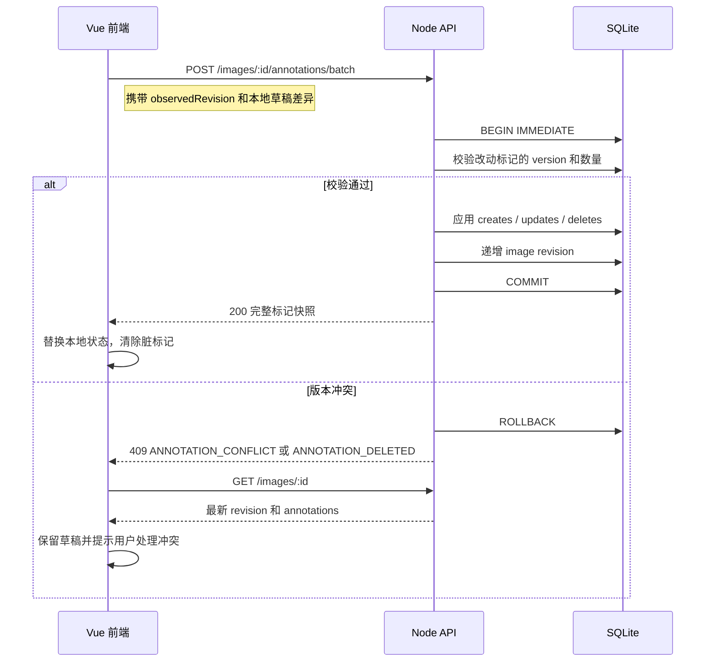

# 审图打点 API 设计

接口版本：`v1`  
状态：前后端均已接入，后端接口通过自动化测试。  
并发粒度与实时同步的下一阶段设计见 [`REALTIME_CONCURRENCY.md`](REALTIME_CONCURRENCY.md)。

## 1. 基本约定

### 1.1 地址

开发环境后端地址：

```text
http://127.0.0.1:3001
```

业务接口统一使用 `/api/v1` 前缀，健康检查保留在 `/api/health`。

前端建议通过 `VITE_API_BASE_URL` 配置 API 地址，默认值：

```dotenv
VITE_API_BASE_URL=http://127.0.0.1:3001/api/v1
```

### 1.2 数据格式

- 请求和响应正文使用 UTF-8 JSON，文件上传除外。
- 时间统一使用 ISO 8601 UTC 字符串，例如 `2026-10-20T08:07:22.924Z`。
- 资源 ID 使用 UUID v4 字符串。
- 图片 ID 和标注 ID 均为字符串，前端不得按数字处理。
- 除特别说明外，创建成功返回 `201`，查询和更新成功返回 `200`。

### 1.3 操作人识别

该产品没有密码和完整权限系统，只识别“当前是谁在操作”。

1. 前端首次进入时要求输入姓名。
2. 调用 `POST /api/v1/session` 获取或创建操作人。
3. 前端把返回的操作人档案保存在 `localStorage` 的操作人目录中。
4. 当前标签页把正在使用的 `operator.id` 保存在 `sessionStorage`，因此同一浏览器的不同标签页可以使用不同操作人。
5. 所有写接口必须携带请求头：

```http
X-Operator-Id: 3f2f3ca8-8b0b-43e5-83dd-a866ec6d7781
```

6. 查询接口不要求该请求头。
7. 写接口返回 `OPERATOR_REQUIRED` 时，前端清除失效档案并重新让用户选择或输入姓名。

说明：这是协作身份标识，不是安全认证。知道 ID 的人可以冒用身份；本项目不把它当作登录鉴权。

### 1.4 坐标约定

标注坐标一律保存为**图片原始像素坐标**，不能保存页面坐标、容器坐标或缩放后的坐标。

- 原点：图片左上角 `(0, 0)`。
- `x`：水平像素坐标，满足 `0 <= x < image.width`。
- `y`：垂直像素坐标，满足 `0 <= y < image.height`。
- 最多保留 2 位小数，服务端四舍五入。
- 标注位置创建后不可修改。位置标错时应删除后重新添加。

前端渲染公式：

```text
screenX = containerLeft + panX + imageX * scale
screenY = containerTop + panY + imageY * scale
```

反向换算：

```text
imageX = (pointerX - containerLeft - panX) / scale
imageY = (pointerY - containerTop - panY) / scale
```

完整的缩放、平移、双指手势、图钉反向缩放和验收测试见 [`VIEWPORT_ALGORITHM.md`](VIEWPORT_ALGORITHM.md)。

### 1.5 标注规则

- 一张图最多 50 个标记。
- 每个标记必须有 1～200 字的说明，前后空白会被裁掉。
- 标记编号由服务端分配，在同一张图内单调递增，删除后不复用。
- 标记按 `number` 升序返回。
- 当前版本允许所有操作人编辑和删除任意标记；`author` 始终表示创建人。
- 标记位置不可拖动，说明可以编辑。

### 1.6 请求 ID

客户端可发送：

```http
X-Request-Id: 9d10511d-8a26-4f09-a144-a9eb61c73293
```

服务端在响应头和错误正文中返回同一个 ID。客户端未发送时由服务端生成，用于定位日志。

## 2. 通用数据模型

### 2.1 Operator

```json
{
  "id": "3f2f3ca8-8b0b-43e5-83dd-a866ec6d7781",
  "displayName": "王芳",
  "color": "#2563EB",
  "createdAt": "2026-10-20T08:07:22.924Z"
}
```

`color` 由服务端分配，用于前端区分作者。颜色不能作为唯一识别信息，界面仍需显示姓名和编号。

### 2.2 ImageSummary

```json
{
  "id": "4fa8fd31-1863-4e38-b20f-1d3f923ddcc3",
  "title": "秋季新品主图",
  "width": 1920,
  "height": 1080,
  "imageUrl": "/api/v1/images/4fa8fd31-1863-4e38-b20f-1d3f923ddcc3/content",
  "revision": 7,
  "annotationCount": 3,
  "createdAt": "2026-10-20T08:07:22.924Z",
  "lastAnnotatedAt": "2026-10-20T09:12:00.000Z"
}
```

- `revision`：图片标注集合的版本号，每次新增、修改或删除标记后递增。
- `annotationCount`：当前标记数量。
- `lastAnnotatedAt`：最后一次标注变更时间，没有标记时为 `null`。
- `imageUrl`：相对地址，前端使用 API 服务源地址拼接。
- 不返回服务器文件路径或原始文件名，避免暴露本地目录结构。

### 2.3 Annotation

```json
{
  "id": "9fd9b6c9-60ba-4c26-a3a7-7ba372d17700",
  "number": 2,
  "x": 842.5,
  "y": 310.25,
  "note": "价格字体偏小，需要放大",
  "author": {
    "id": "3f2f3ca8-8b0b-43e5-83dd-a866ec6d7781",
    "displayName": "王芳",
    "color": "#2563EB"
  },
  "version": 1,
  "createdAt": "2026-10-20T09:10:00.000Z",
  "updatedAt": "2026-10-20T09:10:00.000Z"
}
```

`version` 用于乐观锁。每次修改说明后递增，删除时也必须携带调用方最后看到的版本。

### 2.4 ErrorResponse

```json
{
  "error": {
    "code": "ANNOTATION_CONFLICT",
    "message": "该标记已被其他同事修改，请刷新后重试",
    "requestId": "9d10511d-8a26-4f09-a144-a9eb61c73293",
    "details": {
      "annotationId": "9fd9b6c9-60ba-4c26-a3a7-7ba372d17700",
      "currentVersion": 3,
      "currentNote": "远端已经修改后的说明",
      "currentImageRevision": 8
    }
  }
}
```

`details` 是可选字段，结构由错误码决定。`message` 可以直接展示给用户。

## 3. 接口总览

| 方法 | 路径 | 用途 | 操作人请求头 |
|---|---|---|---|
| GET | `/api/health` | 服务和数据库健康检查 | 否 |
| POST | `/api/v1/session` | 按姓名获取或创建操作人 | 否 |
| GET | `/api/v1/images` | 图片库列表 | 否 |
| POST | `/api/v1/images` | 上传图片 | 是 |
| GET | `/api/v1/images/:imageId` | 图片详情和全部标记 | 否 |
| GET | `/api/v1/images/:imageId/content` | 读取图片文件 | 否 |
| POST | `/api/v1/images/:imageId/annotations` | 新增单个标记 | 是 |
| PATCH | `/api/v1/annotations/:annotationId` | 修改标记说明 | 是 |
| DELETE | `/api/v1/annotations/:annotationId` | 删除标记 | 是 |
| POST | `/api/v1/images/:imageId/annotations/batch` | 批量保存全部草稿变更 | 是 |
| GET | `/api/v1/events` | SSE 实时变化事件 | 否 |

前端正式保存时统一使用批量接口，单条接口用于调试、测试和后续扩展。

## 4. 会话接口

### POST `/api/v1/session`

根据姓名获取或创建操作人。

请求：

```json
{
  "displayName": "王芳"
}
```

规则：

- 去除首尾空白后长度为 1～30。
- 姓名比较不区分大小写。
- 存在同名操作人时直接返回已有记录。

响应 `200`（已存在）或 `201`（新建）：

```json
{
  "operator": {
    "id": "3f2f3ca8-8b0b-43e5-83dd-a866ec6d7781",
    "displayName": "王芳",
    "color": "#2563EB",
    "createdAt": "2026-10-20T08:07:22.924Z"
  },
  "created": false
}
```

错误：

| HTTP | code | 场景 |
|---|---|---|
| 400 | `VALIDATION_ERROR` | 姓名为空或超过 30 字 |

## 5. 图片接口

### GET `/api/v1/images`

查询图片库。

查询参数：

| 参数 | 类型 | 默认值 | 说明 |
|---|---|---|---|
| `q` | string | 空 | 按标题模糊搜索，最多 50 字 |
| `limit` | integer | 50 | 1～100 |
| `offset` | integer | 0 | 大于等于 0 |

响应 `200`：

```json
{
  "items": [
    {
      "id": "4fa8fd31-1863-4e38-b20f-1d3f923ddcc3",
      "title": "秋季新品主图",
      "width": 1920,
      "height": 1080,
      "imageUrl": "/api/v1/images/4fa8fd31-1863-4e38-b20f-1d3f923ddcc3/content",
      "revision": 7,
      "annotationCount": 3,
      "createdAt": "2026-10-20T08:07:22.924Z",
      "lastAnnotatedAt": "2026-10-20T09:12:00.000Z"
    }
  ],
  "total": 1
}
```

排序规则：`createdAt` 倒序。

### POST `/api/v1/images`

上传本地图片。

请求类型：`multipart/form-data`

| 字段 | 类型 | 必填 | 说明 |
|---|---|---|---|
| `file` | file | 是 | JPG、PNG 或 WebP，最大 10 MB |
| `title` | string | 否 | 1～80 字；不传时使用文件名去掉扩展名 |

服务端要求：

- 同时校验 MIME 类型和文件内容特征，不能只信任扩展名。
- 拒绝 SVG。
- 纠正图片 EXIF 方向后再读取宽高。
- 使用 UUID 作为磁盘文件名，原始文件名不参与路径拼接。
- 文件保存在本机 `data/uploads/`。

响应 `201`：返回 `ImageSummary`。

错误：

| HTTP | code | 场景 |
|---|---|---|
| 400 | `VALIDATION_ERROR` | 标题不合法 |
| 413 | `IMAGE_TOO_LARGE` | 文件超过 10 MB |
| 415 | `UNSUPPORTED_IMAGE_TYPE` | 格式不支持或文件内容不匹配 |

### GET `/api/v1/images/:imageId`

打开图片及其全部标记。

响应 `200`：

```json
{
  "image": {
    "id": "4fa8fd31-1863-4e38-b20f-1d3f923ddcc3",
    "title": "秋季新品主图",
    "width": 1920,
    "height": 1080,
    "imageUrl": "/api/v1/images/4fa8fd31-1863-4e38-b20f-1d3f923ddcc3/content",
    "revision": 7,
    "annotationCount": 1,
    "createdAt": "2026-10-20T08:07:22.924Z",
    "lastAnnotatedAt": "2026-10-20T09:10:00.000Z"
  },
  "annotations": [
    {
      "id": "9fd9b6c9-60ba-4c26-a3a7-7ba372d17700",
      "number": 2,
      "x": 842.5,
      "y": 310.25,
      "note": "价格字体偏小，需要放大",
      "author": {
        "id": "3f2f3ca8-8b0b-43e5-83dd-a866ec6d7781",
        "displayName": "王芳",
        "color": "#2563EB"
      },
      "version": 1,
      "createdAt": "2026-10-20T09:10:00.000Z",
      "updatedAt": "2026-10-20T09:10:00.000Z"
    }
  ]
}
```

一张图最多 50 个标记，因此该接口不分页。

### GET `/api/v1/images/:imageId/content`

返回图片二进制内容。

- 成功：`200`，`Content-Type` 为 `image/jpeg`、`image/png` 或 `image/webp`。
- 支持 `ETag` 和 `If-None-Match`，命中时返回 `304`。
- 图片文件不可变，可使用长期缓存。
- 未找到：`404 IMAGE_NOT_FOUND`。

## 6. 标注接口

### POST `/api/v1/images/:imageId/annotations`

新增单个标记。

请求头：

```http
X-Operator-Id: 3f2f3ca8-8b0b-43e5-83dd-a866ec6d7781
```

请求：

```json
{
  "id": "9fd9b6c9-60ba-4c26-a3a7-7ba372d17700",
  "x": 842.5,
  "y": 310.25,
  "note": "价格字体偏小，需要放大"
}
```

`id` 由前端生成，用于防止网络重试产生重复标记。

响应 `201`：

```json
{
  "annotation": {
    "id": "9fd9b6c9-60ba-4c26-a3a7-7ba372d17700",
    "number": 3,
    "x": 842.5,
    "y": 310.25,
    "note": "价格字体偏小，需要放大",
    "author": {
      "id": "3f2f3ca8-8b0b-43e5-83dd-a866ec6d7781",
      "displayName": "王芳",
      "color": "#2563EB"
    },
    "version": 1,
    "createdAt": "2026-10-20T09:10:00.000Z",
    "updatedAt": "2026-10-20T09:10:00.000Z"
  },
  "imageRevision": 8
}
```

幂等规则：

- 相同 `id`、相同坐标、相同说明重复提交时返回 `200` 和已有标记。
- 相同 `id` 但内容不同，返回 `409 ANNOTATION_ID_CONFLICT`。

错误：

| HTTP | code | 场景 |
|---|---|---|
| 400 | `OPERATOR_REQUIRED` | 缺少或未知 `X-Operator-Id` |
| 400 | `VALIDATION_ERROR` | 坐标越界、说明为空或超过 200 字 |
| 404 | `IMAGE_NOT_FOUND` | 图片不存在 |
| 409 | `ANNOTATION_LIMIT_REACHED` | 已达到 50 个标记 |
| 409 | `ANNOTATION_ID_CONFLICT` | 标记 ID 已被不同内容使用 |

### PATCH `/api/v1/annotations/:annotationId`

修改标记说明。位置不可修改。

请求：

```json
{
  "note": "价格字体需要放大到 36px",
  "version": 1
}
```

响应 `200`：

```json
{
  "annotation": {
    "id": "9fd9b6c9-60ba-4c26-a3a7-7ba372d17700",
    "number": 3,
    "x": 842.5,
    "y": 310.25,
    "note": "价格字体需要放大到 36px",
    "author": {
      "id": "3f2f3ca8-8b0b-43e5-83dd-a866ec6d7781",
      "displayName": "王芳",
      "color": "#2563EB"
    },
    "version": 2,
    "createdAt": "2026-10-20T09:10:00.000Z",
    "updatedAt": "2026-10-20T09:20:00.000Z"
  },
  "imageRevision": 9
}
```

`version` 不是当前版本时返回 `409 ANNOTATION_CONFLICT`，并附上当前版本。

### DELETE `/api/v1/annotations/:annotationId?version=2`

删除标记。

查询参数 `version` 必填，为调用方最后看到的标记版本。

响应 `200`：

```json
{
  "deletedId": "9fd9b6c9-60ba-4c26-a3a7-7ba372d17700",
  "imageRevision": 10
}
```

重复删除同一标记时返回 `404 ANNOTATION_NOT_FOUND`。

### POST `/api/v1/images/:imageId/annotations/batch`

一次保存页面上的全部新增、修改和删除。前端“保存修改”按钮使用此接口。

请求：

```json
{
  "observedRevision": 7,
  "creates": [
    {
      "id": "a60957af-307f-4cdc-8d40-f2a7c07e46b2",
      "x": 150.25,
      "y": 420,
      "note": "主标题需要上移"
    }
  ],
  "updates": [
    {
      "id": "9fd9b6c9-60ba-4c26-a3a7-7ba372d17700",
      "version": 1,
      "note": "价格字体需要放大到 36px"
    }
  ],
  "deletes": [
    {
      "id": "cf9d8111-520c-4db3-9077-9f4658f74fa2",
      "version": 2
    }
  ]
}
```

规则：

- `observedRevision` 可选，表示客户端最后看到的图片版本，不用于拒绝不同标记的并发保存。
- 兼容旧客户端，仍可传 `baseRevision`，语义与 `observedRevision` 相同。
- `creates`、`updates`、`deletes` 可省略，默认空数组；但三者合计至少一项。
- 单次合计最多 50 项，保存后的标记总数不能超过 50。
- 所有变更在同一个 SQLite 事务中提交，任何一项失败则全部回滚。
- 任一新标记 ID 已存在时，按单条新增的幂等规则处理。
- 修改和删除只校验对应标记的 `version`，不会因为其他人修改了别的标记而失败。
- 成功后图片 `revision` 只递增一次。

响应 `200`：

```json
{
  "imageRevision": 8,
  "annotations": [
    {
      "id": "9fd9b6c9-60ba-4c26-a3a7-7ba372d17700",
      "number": 2,
      "x": 842.5,
      "y": 310.25,
      "note": "价格字体需要放大到 36px",
      "author": {
        "id": "3f2f3ca8-8b0b-43e5-83dd-a866ec6d7781",
        "displayName": "王芳",
        "color": "#2563EB"
      },
      "version": 2,
      "createdAt": "2026-10-20T09:10:00.000Z",
      "updatedAt": "2026-10-20T09:20:00.000Z"
    },
    {
      "id": "a60957af-307f-4cdc-8d40-f2a7c07e46b2",
      "number": 4,
      "x": 150.25,
      "y": 420,
      "note": "主标题需要上移",
      "author": {
        "id": "3f2f3ca8-8b0b-43e5-83dd-a866ec6d7781",
        "displayName": "王芳",
        "color": "#2563EB"
      },
      "version": 1,
      "createdAt": "2026-10-20T09:25:00.000Z",
      "updatedAt": "2026-10-20T09:25:00.000Z"
    }
  ],
  "savedAt": "2026-10-20T09:25:00.000Z",
  "concurrentChanges": true,
  "changed": {
    "created": ["a60957af-307f-4cdc-8d40-f2a7c07e46b2"],
    "updated": ["9fd9b6c9-60ba-4c26-a3a7-7ba372d17700"],
    "deleted": []
  }
}
```

响应返回保存后的完整快照，前端可以直接替换本地状态，不需要再请求一次详情。

`concurrentChanges = true` 表示保存时客户端看到的图片版本已经落后，但服务端仍成功合并了互不冲突的标记。`changed` 只包含本次实际产生的变化，幂等重试的新增不会重复列出。

#### 标记版本冲突

同一标记在打开后被别人修改时返回 `409 ANNOTATION_CONFLICT`，`details` 包含冲突标记 ID、当前版本和当前说明。

同一标记已被别人删除时返回 `409 ANNOTATION_DELETED`。

#### GET `/api/v1/events`

建立 Server-Sent Events 连接：

```http
GET /api/v1/events?clientId=<tab-uuid>
Accept: text/event-stream
```

连接成功：

```text
event: connected
data: {"serverTime":"2026-10-20T10:00:00.000Z"}
```

图片变化：

```text
event: image.changed
id: 106
data: {
  "eventId": 106,
  "type": "image.changed",
  "imageId": "4fa8fd31-1863-4e38-b20f-1d3f923ddcc3",
  "revision": 9,
  "annotationCount": 5,
  "lastAnnotatedAt": "2026-10-20T10:00:02.000Z",
  "actor": {
    "id": "22222222-2222-4222-8222-222222222222",
    "displayName": "李雷",
    "color": "#059669"
  },
  "sourceClientId": "d6520e2d-6f59-47be-8d95-18b22c845cf0",
  "changed": {
    "created": ["a60957af-307f-4cdc-8d40-f2a7c07e46b2"],
    "updated": [],
    "deleted": []
  }
}
```

事件只在 SQLite 事务提交成功后发送。前端收到事件后重新拉取图片详情，并按 `base/server/local` 三方合并；`sourceClientId` 与当前标签页一致时忽略自己的回声。

## 7. 错误码

| HTTP | code | 说明 |
|---|---|---|
| 400 | `VALIDATION_ERROR` | 参数格式或业务约束不合法 |
| 400 | `OPERATOR_REQUIRED` | 写请求缺少或携带未知操作人 |
| 404 | `NOT_FOUND` | 路由不存在 |
| 404 | `IMAGE_NOT_FOUND` | 图片不存在 |
| 404 | `ANNOTATION_NOT_FOUND` | 标记不存在 |
| 409 | `ANNOTATION_CONFLICT` | 标记版本过期 |
| 409 | `ANNOTATION_DELETED` | 标记已被其他同事删除 |
| 409 | `ANNOTATION_LIMIT_REACHED` | 标记数量超过 50 |
| 409 | `ANNOTATION_ID_CONFLICT` | 标记 ID 内容冲突 |
| 413 | `IMAGE_TOO_LARGE` | 上传图片超过 10 MB |
| 415 | `UNSUPPORTED_IMAGE_TYPE` | 图片格式不支持 |
| 500 | `INTERNAL_ERROR` | 未处理的服务端异常 |

校验错误可返回字段明细：

```json
{
  "error": {
    "code": "VALIDATION_ERROR",
    "message": "请求参数不合法",
    "requestId": "9d10511d-8a26-4f09-a144-a9eb61c73293",
    "details": {
      "fields": [
        {
          "path": "creates[0].note",
          "message": "说明不能为空"
        }
      ]
    }
  }
}
```

## 8. 前端调用流程

### 8.1 首次进入

1. 从 `sessionStorage` 读取当前标签页的操作人 ID。
2. 当前标签页没有身份时，展示 `localStorage` 中已保存的操作人列表。
3. 用户可以选择已有操作人，或输入新姓名并调用 `POST /api/v1/session`。
4. 操作人档案写入 `localStorage`，当前标签页身份写入 `sessionStorage`。
5. 后续请求自动带 `X-Operator-Id`；其他标签页保持自己的身份不变。
6. 写请求返回 `OPERATOR_REQUIRED` 时，清除失效档案并重新执行上述流程。

### 8.2 打开图片

1. `GET /api/v1/images` 渲染图片库。
2. 点击图片后 `GET /api/v1/images/:imageId`。
3. 保存返回的 `image.revision` 和 `annotations`。
4. 图片和标记层使用同一个缩放、平移容器。
5. 标记坐标直接使用图片原始像素，不随缩放重新计算存储值。

### 8.3 本地编辑

1. 点击图片空白区域时换算为图片像素坐标。
2. 生成客户端 UUID，创建本地草稿标记。
3. 用户填写说明后进入待保存列表。
4. 页面显示“有 N 处未保存修改”。
5. 为空说明的草稿不允许保存。

### 8.4 保存

1. 将本地状态与打开时的服务端快照比较，生成 `creates`、`updates`、`deletes`。
2. 携带最后看到的 `observedRevision` 调用批量接口。
3. 成功后用响应中的 `annotations` 和 `imageRevision` 替换本地状态。
4. 收到其他标签页的 `image.changed` 事件后拉取最新详情并执行三方合并。
5. 只有同一标记版本冲突时保留双方版本并让用户选择。



### 8.5 离开保护

存在未保存修改时：

- 切换图片前弹出确认。
- 关闭或刷新页面前触发 `beforeunload`。
- 保存成功后清除脏状态。

## 9. 调用示例

创建会话：

```powershell
$session = Invoke-RestMethod `
  -Method Post `
  -Uri 'http://127.0.0.1:3001/api/v1/session' `
  -ContentType 'application/json' `
  -Body '{"displayName":"王芳"}'

$headers = @{ 'X-Operator-Id' = $session.operator.id }
```

查询图片：

```powershell
Invoke-RestMethod -Uri 'http://127.0.0.1:3001/api/v1/images'
```

批量保存：

```powershell
$body = @{
  observedRevision = 7
  creates = @(
    @{
      id = 'a60957af-307f-4cdc-8d40-f2a7c07e46b2'
      x = 150.25
      y = 420
      note = '主标题需要上移'
    }
  )
  updates = @()
  deletes = @()
} | ConvertTo-Json -Depth 8

Invoke-RestMethod `
  -Method Post `
  -Uri 'http://127.0.0.1:3001/api/v1/images/4fa8fd31-1863-4e38-b20f-1d3f923ddcc3/annotations/batch' `
  -Headers $headers `
  -ContentType 'application/json' `
  -Body $body
```

## 10. 当前不做的接口

以下能力不在 v1 范围内，避免扩大作业边界：

- 图片删除和替换
- 标注区域框选
- 标记位置拖动
- 管理员、角色和权限管理
- 标注评论线程
- 实时多人推送
- 图片和标注导出
- 远程对象存储

如后续需要，优先从批量接口和版本号基础上扩展。
