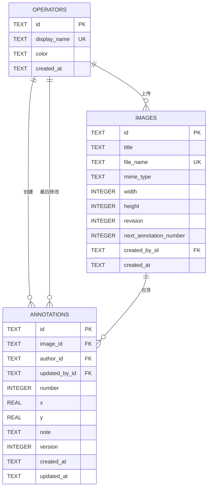

# 审图打点数据库设计

数据库版本：SQLite schema v2  
数据库文件：`apps/server/data/app.db`  
迁移实现：[migrations.ts](../apps/server/src/db/migrations.ts)

## 1. 设计目标

数据库需要同时保证四件事：

1. 标记坐标永久对应图片原始像素，不受屏幕尺寸和缩放影响。
2. 每次操作都能识别操作人，并保留标记创建人和最后修改人。
3. 标记编号稳定，删除后不复用，避免同事引用错误。
4. 多个页面同时编辑时，不静默覆盖别人的修改。

## 2. SQLite 使用方式

SQLite 是嵌入式数据库，不是独立服务：

- 不需要安装数据库服务、配置端口或账号。
- Node 进程直接打开 `data/app.db` 文件。
- 实际数据库由 [database.ts](../apps/server/src/db/database.ts) 打开。
- 前端不直接连接数据库，只通过 HTTP API 访问 Node 后端。

每次打开连接时执行：

```sql
PRAGMA foreign_keys = ON;
PRAGMA busy_timeout = 5000;
PRAGMA journal_mode = WAL;
```

说明：

- `foreign_keys`：启用外键约束。SQLite 默认可能关闭，因此每个连接都必须显式设置。
- `WAL`：读写并发更好，普通查询不会被写事务长时间阻塞。
- `busy_timeout`：遇到短暂写锁时最多等待 5 秒，降低 `SQLITE_BUSY` 概率。

WAL 模式下会同时出现：

```text
app.db
app.db-wal
app.db-shm
```

这三个文件属于同一个数据库，不能只复制或删除其中一个。

## 3. 实体关系



关系规则：

- 一张图可以有 0～50 个标记。
- 一个标记必须属于一张图和一个创建人。
- `updated_by_id` 可以为空，表示从未被修改过。
- 删除图片时标记级联删除。
- 操作人被标记引用时禁止删除，防止作者信息丢失。

## 4. 表结构

### 4.1 operators

保存轻量操作人身份，不保存密码、Token、邮箱或角色。

| 字段 | 类型 | 可空 | 默认值 | 约束 | 说明 |
|---|---|---|---:|---|---|
| `id` | TEXT | 否 | - | PRIMARY KEY | UUID v4 |
| `display_name` | TEXT | 否 | - | UNIQUE，NOCASE | 界面显示姓名 |
| `color` | TEXT | 否 | - | - | 标记颜色，如 `#2563EB` |
| `created_at` | TEXT | 否 | UTC 时间 | - | 首次创建时间 |

设计说明：

- `display_name` 使用 `COLLATE NOCASE` 唯一索引，`Alice` 和 `alice` 视为同一人。
- 中文姓名按原始字符比较。
- 姓名长度 1～30、去除首尾空白由应用层校验。
- 颜色使用预设高对比度色板，不能由客户端任意指定。
- 本项目不提供身份认证，`operator.id` 只用于操作归属。

### 4.2 images

保存图片元数据。图片文件本身保存在 `data/uploads/`，不存入 SQLite BLOB。

| 字段 | 类型 | 可空 | 默认值 | 约束 | 说明 |
|---|---|---:|---|---|---|
| `id` | TEXT | 否 | - | PRIMARY KEY | 图片 UUID |
| `title` | TEXT | 否 | - | 长度 1～80 | 展示标题 |
| `file_name` | TEXT | 否 | - | UNIQUE | 本地存储文件名，使用 UUID |
| `original_name` | TEXT | 是 | NULL | - | 上传时原始文件名 |
| `mime_type` | TEXT | 否 | - | JPEG/PNG/WebP | 服务端识别后的真实类型 |
| `byte_size` | INTEGER | 否 | 0 | `>= 0` | 文件字节数 |
| `checksum_sha256` | TEXT | 是 | NULL | 64 位 | 文件 SHA-256 |
| `width` | INTEGER | 否 | - | `> 0` | 图片原始像素宽度 |
| `height` | INTEGER | 否 | - | `> 0` | 图片原始像素高度 |
| `revision` | INTEGER | 否 | 1 | `> 0` | 标注集合变化游标 |
| `next_annotation_number` | INTEGER | 否 | 1 | `> 0` | 下一个标记编号 |
| `created_by_id` | TEXT | 是 | NULL | FK → operators | 上传人；演示图可为空 |
| `created_at` | TEXT | 否 | UTC 时间 | - | 创建时间 |

为什么文件不放进数据库：

- 图片通常几百 KB 到数 MB，放入 BLOB 会放大数据库和备份体积。
- 浏览器可以通过图片 URL 直接加载文件，并利用 HTTP 缓存。
- 数据库只保存元数据，读写更轻量。

安全规则：

- `file_name` 只由服务端生成，不能直接使用用户上传的文件名。
- `original_name` 仅作展示和下载命名，不参与路径拼接。
- `mime_type` 必须根据文件内容判断，不能只信任扩展名。
- 图片文件不可替换，因此没有 `updated_at`。

### 4.3 annotations

保存标记位置、说明、作者和并发版本。

| 字段 | 类型 | 可空 | 默认值 | 约束 | 说明 |
|---|---|---:|---|---|---|
| `id` | TEXT | 否 | - | PRIMARY KEY | 前端生成的 UUID |
| `image_id` | TEXT | 否 | - | FK → images，CASCADE | 所属图片 |
| `author_id` | TEXT | 否 | - | FK → operators，RESTRICT | 创建人 |
| `updated_by_id` | TEXT | 是 | NULL | FK → operators，SET NULL | 最后修改人 |
| `number` | INTEGER | 否 | - | `> 0`，图内唯一 | 稳定标记编号 |
| `x` | REAL | 否 | - | `>= 0` | 原始像素横坐标 |
| `y` | REAL | 否 | - | `>= 0` | 原始像素纵坐标 |
| `note` | TEXT | 否 | - | 去空格后 1～200 字 | 问题说明 |
| `version` | INTEGER | 否 | 1 | `> 0` | 标记乐观锁版本 |
| `created_at` | TEXT | 否 | UTC 时间 | - | 创建时间 |
| `updated_at` | TEXT | 否 | UTC 时间 | - | 最后修改时间 |

唯一约束：

```sql
UNIQUE (image_id, number)
```

标记编号由服务端分配，创建后不变。图片表保存 `next_annotation_number`，新增标记时在事务内递增，因此即使删除编号最大的标记，该编号也不会再次使用。

作者字段语义：

- `author_id` 永远表示创建人。
- 其他同事编辑说明时，`author_id` 不变。
- `updated_by_id` 记录最后修改人。
- 删除标记时整行删除，v1 不保留历史快照。

位置规则：

- `x`、`y` 存图片原始像素，不存百分比和页面坐标。
- 应用层保留最多 2 位小数。
- 数据库触发器保证 `x < image.width`、`y < image.height`。
- 位置创建后不可修改，标错时需要删除后重新创建。

### 4.4 schema_migrations

记录已经执行的迁移，避免服务重启时重复建表。

| 字段 | 类型 | 可空 | 约束 | 说明 |
|---|---|---|---|---|
| `version` | INTEGER | 否 | PRIMARY KEY | 迁移序号 |
| `name` | TEXT | 否 | - | 迁移名称 |
| `applied_at` | TEXT | 否 | 默认 UTC 时间 | 执行时间 |

当前版本：

| version | name |
|---:|---|
| 1 | `initial_schema` |
| 2 | `annotation_numbers_and_image_metadata` |

## 5. 索引设计

| 索引 | 字段 | 用途 |
|---|---|---|
| 主键 | `images.id` | 按 ID 打开图片 |
| 唯一 | `images.file_name` | 防止文件重名 |
| 普通 | `images.created_at` | 图片库按创建时间倒序 |
| 主键 | `annotations.id` | 单条修改和删除 |
| 唯一 | `annotations(image_id, number)` | 图内编号唯一、按编号排序 |
| 普通 | `annotations(image_id, created_at)` | 兼容按创建顺序查询 |
| 普通 | `annotations(image_id, updated_at)` | 计算最后标注时间 |
| 普通 | `annotations(author_id, created_at)` | 按作者筛选和统计 |
| 唯一 | `operators.display_name` | 同名操作人复用 |

单张图最多 50 个标记，因此图片详情不需要分页，也不需要额外缓存表。

## 6. 数据完整性约束

### 6.1 外键

- `annotations.image_id → images.id ON DELETE CASCADE`
- `annotations.author_id → operators.id ON DELETE RESTRICT`
- `annotations.updated_by_id → operators.id ON DELETE SET NULL`
- `images.created_by_id → operators.id ON DELETE SET NULL`

图片删除不开放给 API，但数据库仍定义了合理的级联行为。

### 6.2 数据库 CHECK

数据库直接拒绝以下数据：

- 空标题或标题超过 80 字
- 不支持的 MIME 类型
- 负数文件大小
- 非 64 位 SHA-256
- 非正数图片宽高
- 非正数图片版本
- 非正数下一个标记编号
- 空说明或超过 200 字
- 负坐标
- 非正数标记版本
- 非正数标记编号

### 6.3 触发器

`annotations_bounds_insert`：

- 新增标记时读取图片宽高。
- 拒绝 `x >= width` 或 `y >= height` 的落点。

`annotations_bounds_update`：

- 更新位置时再次检查边界。

`annotations_position_immutable`：

- 只要 `x` 或 `y` 发生变化就中止更新。
- 即使绕过 API 直接执行 SQL，也不能移动已有标记。

### 6.4 应用层约束

以下规则依赖应用事务，不单独由 CHECK 完成：

- 一张图最多 50 个标记。
- 说明和姓名在写入前执行 trim。
- 坐标四舍五入到 2 位小数。
- 图片上传最大 10 MB。
- 批量保存必须一次成功或全部回滚。

## 7. 并发与事务

### 7.1 两个版本号

`images.revision`：

- 表示整张图片标注集合的变化游标。
- 任何新增、修改或删除成功后递增 1。
- 用于比较客户端看到的版本、刷新提示和实时事件去重。
- 不再作为拒绝整张图并发保存的硬性锁。

`annotations.version`：

- 表示单个标记的版本。
- 修改说明或删除标记时校验，是唯一的写冲突依据。
- 两人修改不同标记时可以合并保存。
- 两人修改同一标记时，后提交者收到冲突。

### 7.2 批量保存事务

推荐实现：

```text
BEGIN IMMEDIATE

1. 查询图片当前事件游标
2. 校验所有 updates / deletes 的 annotations.version
3. 幂等处理 creates，并检查标记 ID 冲突
4. 检查保存后的标记总数不超过 50
5. 按 next_annotation_number 分配新编号
6. 执行插入、更新和删除
7. 更新 annotations.updated_at 和 updated_by_id
8. images.revision += 1
9. images.next_annotation_number += 新增数量
10. COMMIT
```

使用 `BEGIN IMMEDIATE` 提前获取写锁，避免两个保存请求同时读取同一版本后再同时写入。

SQLite 同一时刻只有一个写事务。当前工具规模不需要行级锁或连接池。

### 7.3 查询图片列表

列表中的标记数量和最后标注时间由聚合查询得到：

```sql
SELECT
  i.id,
  i.title,
  i.width,
  i.height,
  i.revision,
  i.created_at,
  COUNT(a.id) AS annotation_count,
  MAX(a.updated_at) AS last_annotated_at
FROM images AS i
LEFT JOIN annotations AS a ON a.image_id = i.id
GROUP BY i.id
ORDER BY i.created_at DESC;
```

不把 `annotation_count` 和 `last_annotated_at` 冗余存入 `images`，避免出现计数与真实标记不一致。

## 8. 迁移策略

迁移在服务启动、数据库打开时自动执行：

1. 创建 `schema_migrations`。
2. 查询已经执行的版本。
3. 按版本顺序执行未执行迁移。
4. 每个迁移使用事务，失败则回滚。
5. 成功后写入版本记录。

规则：

- 已发布的迁移文件不能修改，只能新增版本。
- 表结构变更必须兼容已有数据。
- 数据迁移使用临时表复制、校验，再替换旧表。
- 迁移前建议备份 `app.db`。

v2 迁移实际执行了：

- 为图片补充 MIME、文件大小、校验和、上传人和标记编号计数器。
- 为标记补充稳定编号和最后修改人。
- 根据已有标记回填编号。
- 重建索引和外键。
- 增加坐标边界与位置不可变触发器。

## 9. 演示数据设计

演示数据通过可重复执行的 seed 脚本写入，建议使用稳定 UUID 和 `INSERT OR IGNORE`。

演示内容：

- 2～3 个操作人
- 3 张自制海报或商品详情图
- 每张图 2～4 个示例标记

示例图片文件放在：

```text
apps/server/data/uploads/
```

数据库只保存元数据。演示图使用固定文件名，方便迁移和截图复现。

seed 脚本不能删除真实数据，只允许插入缺失记录。

## 10. 备份与恢复

推荐在线备份命令：

```powershell
sqlite3 apps\server\data\app.db ".backup 'app-backup.db'"
```

恢复流程：

1. 停止后端。
2. 将当前 `app.db`、`app.db-wal`、`app.db-shm` 移到备份目录。
3. 放入待恢复的 `app.db`。
4. 启动后端并调用 `GET /api/health`。

不要只复制正在写入的 `app.db` 而忽略 WAL 文件；使用 `.backup` 可以生成一致快照。

## 11. 安全边界

- SQLite 文件只保存在本机，不接远程数据库。
- 所有 SQL 使用参数绑定，禁止拼接用户输入。
- 上传文件名由服务端 UUID 化，防止路径穿越。
- 图片 BLOB 不进入数据库，降低误导出和泄露风险。
- 操作人 ID 不构成安全认证，清楚知道 ID 的人可以冒用。
- 若未来部署到公网，必须增加账号认证、图片访问控制和数据库加密等能力。

## 12. 验证记录

数据库实际升级后：

```text
schema_migrations:
1 | initial_schema
2 | annotation_numbers_and_image_metadata

PRAGMA foreign_key_check:
无输出，表示没有外键错误
```

自动化测试验证：

- 健康检查返回 `migrationCount: 2`
- 越界坐标插入被 `annotation_out_of_bounds` 拒绝
- 修改已有标记坐标被 `annotation_position_immutable` 拒绝
- `npm run typecheck` 通过
- `npm test` 全部通过
