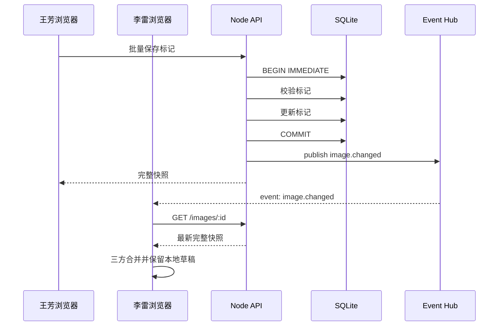

# 细粒度并发与实时同步设计

状态：已实现并通过双浏览器端到端测试。  
适用版本：v1 后端与 Vue 前端。

## 1. 目标

解决两个问题：

1. 不同同事修改不同标记时，可以同时保存，不因整张图版本变化而失败。
2. 一方保存成功后，正在查看同一图片的其他浏览器可以立即看到最新结果。

设计目标：

- 同一标记仍禁止静默覆盖。
- 不同标记可以安全合并。
- 本地草稿不能因为远端更新而丢失。
- 保存提交后只广播已经提交的数据，回滚事务不能发送事件。
- 继续使用本地 SQLite 和单 Node 服务，不引入 Redis、消息队列或远程实时服务。

## 2. 当前问题

当前实现使用图片级乐观锁：

```text
某人修改任意标记
→ images.revision + 1
→ 其他页面保存时 baseRevision 不再匹配
→ 返回 409 IMAGE_REVISION_CONFLICT
```

这会把“不同标记的独立修改”也当成冲突。

当前数据库中已经有：

- `images.revision`：整张图变化游标。
- `annotations.version`：单条标记版本。

单条标记已经具备细粒度并发控制的基础，只需要调整保存规则。

## 3. 新的并发模型

### 3.1 职责拆分

| 字段 | 新职责 |
|---|---|
| `images.revision` | 表示图片内容已经变化，用于 UI 提示、事件去重和增量刷新 |
| `annotations.version` | 唯一的写冲突判断依据 |
| 新标记客户端 UUID | 保证网络重试幂等，不和其他新增标记冲突 |

图片版本不再作为“整图保存许可证”。

### 3.2 保存规则

批量保存在一个 `BEGIN IMMEDIATE` 事务中执行：

1. 读取图片当前版本，但不因为与 `observedRevision` 不同而直接拒绝。
2. 新增标记直接插入。
3. 修改标记时校验该标记的 `version`。
4. 删除标记时校验该标记的 `version`。
5. 在事务内检查最终标记总数不超过 50。
6. 分配稳定编号。
7. 应用全部变更。
8. 图片 `revision` 只递增一次。
9. 提交事务。
10. 提交成功后再发布实时事件。

建议把请求中的 `baseRevision` 改名为 `observedRevision`：

- 可选字段。
- 用于日志、客户端提示和遥测。
- 不满足时返回提示，但不等同于保存失败。

为了兼容已有前端，第一版可以继续接收 `baseRevision`，但不再强制比较。

### 3.3 冲突规则

| 场景 | 结果 |
|---|---|
| 两人修改不同标记 | 都成功，合并保存 |
| 两人新增不同标记 | 都成功，编号连续且唯一 |
| 一人新增、一人修改已有标记 | 都成功 |
| 两人修改同一标记 | 后提交者返回 `409 ANNOTATION_CONFLICT` |
| 一人修改、一人删除同一标记 | 后提交者冲突 |
| 两人删除同一标记 | 先提交者成功，后提交者返回标记已不存在 |
| 合并后数量超过 50 | 后提交者返回 `409 ANNOTATION_LIMIT_REACHED` |

同一标记的冲突响应应包含远端当前值：

```json
{
  "error": {
    "code": "ANNOTATION_CONFLICT",
    "message": "标记 #2 已被李雷修改",
    "details": {
      "annotationId": "9fd9b6c9-60ba-4c26-a3a7-7ba372d17700",
      "currentVersion": 3,
      "currentNote": "李雷修改后的说明",
      "currentImageRevision": 9
    }
  }
}
```

如果标记已被其他人删除：

```json
{
  "error": {
    "code": "ANNOTATION_DELETED",
    "message": "该标记已被其他同事删除",
    "details": {
      "annotationId": "9fd9b6c9-60ba-4c26-a3a7-7ba372d17700",
      "currentImageRevision": 10
    }
  }
}
```

不建议默认使用最后写入覆盖。说明文字可能包含审图意见，静默覆盖比一次明确冲突更危险。

## 4. 实时同步技术选择

### 4.1 推荐 SSE

本项目只需要“服务端保存后通知浏览器”，不需要双向实时通信，因此推荐 Server-Sent Events。

选择 SSE 的原因：

- 原生 `EventSource` 自动重连。
- 实现比 WebSocket 简单。
- 与现有 REST API、HTTP 代理和鉴权方式一致。
- 本地单 Node 服务只需维护连接集合。
- 不需要 Redis 或额外实时服务。

不选 WebSocket 的原因：

- 当前没有实时光标、正在输入、在线状态等双向高频需求。
- WebSocket 会增加连接管理、心跳、代理和重连协议复杂度。

如果以后需要多人实时光标和逐字同步，再升级 WebSocket。

### 4.2 全局事件流

建议提供一个全局连接：

```http
GET /api/v1/events?clientId=<tab-uuid>
Accept: text/event-stream
```

事件包含 `imageId`，各个页面自行过滤：

- 图片画布监听当前图片。
- 图片库监听所有事件并更新标记数量和最近标注时间。

`clientId` 每个标签页独立生成，保存在 `sessionStorage`。服务端在事件中返回 `sourceClientId`，发起保存的标签页可以忽略自己的回声事件。

## 5. 事件协议

### 5.1 连接成功

```text
event: connected
data: {"eventId":105,"serverTime":"2026-10-20T10:00:00.000Z"}
```

### 5.2 图片变化

```text
event: image.changed
id: 106
data: {
  "eventId": 106,
  "type": "image.changed",
  "imageId": "4fa8fd31-1863-4e38-b20f-1d3f923ddcc3",
  "revision": 9,
  "annotationCount": 5,
  "lastAnnotatedAt": "2026-10-20T10:00:02.000Z",
  "actor": {
    "id": "22222222-2222-4222-8222-222222222222",
    "displayName": "李雷",
    "color": "#059669"
  },
  "sourceClientId": "d6520e2d-6f59-47be-8d95-18b22c845cf0",
  "changed": {
    "created": ["a60957af-307f-4cdc-8d40-f2a7c07e46b2"],
    "updated": ["9fd9b6c9-60ba-4c26-a3a7-7ba372d17700"],
    "deleted": []
  }
}
```

事件只发变化摘要，不直接携带完整标记列表。接收方如果需要画布数据，调用：

```http
GET /api/v1/images/:imageId
```

单张图最多 50 个标记，这次请求在本地通常小于 100ms。这样既保持事件轻量，也确保客户端拿到同一事务提交后的完整快照。

### 5.3 心跳

每 15 秒发送 SSE 注释：

```text
: heartbeat
```

用途是保持代理连接并检测失效客户端。

## 6. 后端事件中心

新增进程内 `ImageEventHub`：

```text
connections: Set<SseClient>
eventId: number

publish(event):
  eventId += 1
  向所有连接发送 event

subscribe(connection):
  加入 connections
  cleanup 时移除
```

发布时机：

```text
BEGIN IMMEDIATE
校验单条标记版本
写 annotations
images.revision + 1
COMMIT 成功
→ publish(image.changed)
```

不能在事务提交前广播。否则事务回滚后，其他客户端会收到不存在的变化。

推送失败不能导致保存失败：

- 事件中心异常只记录日志。
- 数据库事务已经提交时，保存响应仍应成功。

单 Node 进程的事件中心足够支持本项目。若以后部署多实例，需要增加 SQLite outbox 轮询或 Redis Pub/Sub。

## 7. 前端三方合并

前端需要区分三份状态：

```ts
interface EditorSnapshots {
  base: Map<string, Annotation>
  server: Map<string, Annotation>
  local: Map<string, LocalAnnotation>
}
```

含义：

- `base`：本标签页最后一次成功同步时看到的版本，用于判断本地改了什么。
- `server`：当前服务端最新快照。
- `local`：用户正在编辑的页面状态，包含本地草稿。

### 7.1 收到事件

```text
收到 image.changed
→ 如果 imageId 不是当前图片，只更新图片库摘要
→ 如果 eventId <= 已处理事件，忽略
→ 如果是本标签页 sourceClientId，忽略
→ 拉取 GET /images/:imageId
→ 执行三方合并
```

### 7.2 合并规则

对远端快照中的每个标记：

1. 本地没有、也没有删除它：直接加入。
2. 本地未修改：使用远端版本，并更新 `base`。
3. 本地已修改，远端版本与 `base.version` 相同：保留本地修改。
4. 本地已修改，远端版本高于 `base.version`：标记为“同一标记冲突”，保留本地草稿和远端副本。
5. 远端删除，本地未修改：从页面移除。
6. 远端删除，本地已修改：标记为“远端已删除冲突”，保留本地草稿。

对本地新增标记：

- 不参与远端冲突。
- 远端快照拉取后继续保留。
- 后续保存时作为 `creates` 提交。

### 7.3 冲突 UI

同一标记冲突时，不能直接覆盖用户输入。建议显示：

```text
李雷刚修改了标记 #2

远端说明：折扣数字再放大 20%
我的草稿：折扣数字需要加大，并上移 12px

[使用远端说明] [保留我的草稿]
```

如果用户保留本地草稿，保存时仍会收到 `ANNOTATION_CONFLICT`。界面应要求用户确认当前远端版本或手动重新编辑，不能静默强制覆盖。

### 7.4 非冲突更新提示

自动合并成功后显示轻提示：

```text
已同步 李雷 的 2 处修改
```

如果当前没有本地草稿，合并是完整自动的。

## 8. 重连与降级

### 8.1 EventSource 重连

浏览器 `EventSource` 会自动重连。每次触发 `open` 后：

1. 重新请求当前图片详情。
2. 执行相同三方合并。
3. 重新加载图片库摘要。

即使中间漏掉事件，完整详情请求也能恢复最终状态。

### 8.2 SSE 不可用

增加兜底轮询：

- 图片详情每 8 秒检查一次 `revision`。
- 图片库每 15 秒刷新一次。
- 页面重新获得焦点时立即刷新。

SSE 正常时不轮询，避免重复请求。

## 9. API 调整

### 9.1 批量保存

请求改为：

```json
{
  "observedRevision": 7,
  "creates": [],
  "updates": [],
  "deletes": []
}
```

`observedRevision` 可选且不参与拒绝判断。

响应继续返回完整快照：

```json
{
  "imageRevision": 10,
  "annotations": [],
  "savedAt": "2026-10-20T10:00:02.000Z"
}
```

### 9.2 实时事件

新增：

```http
GET /api/v1/events
```

响应类型：

```http
Content-Type: text/event-stream
Cache-Control: no-cache
Connection: keep-alive
X-Accel-Buffering: no
```

### 9.3 单条 CRUD

单条 CRUD 继续使用 `annotations.version` 校验，并在提交成功后发布同样的 `image.changed` 事件。

## 10. 数据库影响

基础功能不需要修改表结构：

- `images.revision`
- `annotations.version`
- `updated_by_id`

已经足够支持细粒度锁和事件触发。

如果后续要求：

- 刷新后恢复事件历史
- 断线期间精确重放每一次变化
- 操作审计

再新增 `annotation_events` 表：

```sql
CREATE TABLE annotation_events (
  id INTEGER PRIMARY KEY,
  image_id TEXT NOT NULL,
  actor_id TEXT NOT NULL,
  action TEXT NOT NULL,
  annotation_id TEXT,
  from_version INTEGER,
  to_version INTEGER,
  payload_json TEXT,
  created_at TEXT NOT NULL
);
```

v1 实时同步不需要持久化事件，重连时拉取最新完整快照即可。

## 11. 保存时序



## 12. 验收用例

### 12.1 并发保存

1. 王芳修改标记 #1，李雷修改标记 #2，两人都保存成功。
2. 两人修改标记 #1，后提交者收到 `ANNOTATION_CONFLICT`。
3. 王芳删除标记 #1，李雷修改标记 #1，李雷收到 `ANNOTATION_DELETED`。
4. 两人同时新增标记，编号不同且最终数量正确。
5. 合并后超过 50 个标记时，后提交者收到数量上限错误。

### 12.2 实时同步

1. 李雷保存后，王芳页面在本地环境 500ms 内看到变化。
2. 王芳没有草稿时，远端变化自动合并。
3. 王芳正在编辑其他标记时，远端变化自动合并，本地草稿不丢失。
4. 两人编辑同一标记时，王芳看到双版本冲突界面。
5. SSE 断开后恢复连接，页面会自动拉取最新快照。
6. 图片库中的标记数量和最近标注时间随事件更新。

### 12.3 一致性

1. 保存事务回滚时不会发出 `image.changed`。
2. 同一事件重复到达不会重复添加标记。
3. 同一标签页收到自己的事件不会造成闪烁或重复应用。
4. 重连后即使漏掉多个事件，最终快照仍与服务端一致。

## 13. 实施顺序

第一阶段：细粒度保存

1. 后端移除 `baseRevision` 强制拦截。
2. 保留并强化单标记 `version` 校验。
3. 扩展冲突详情。
4. 补充不同标记并发保存测试。
5. 前端按 `ANNOTATION_CONFLICT` 而不是 `IMAGE_REVISION_CONFLICT` 展示冲突。

第二阶段：SSE

1. 实现事件中心和 `/api/v1/events`。
2. 所有提交成功的标记写操作发布事件。
3. 增加心跳、断连清理和事件测试。

第三阶段：前端实时合并

1. 增加每标签页 `clientId`。
2. 建立 EventSource 连接。
3. 实现 base/server/local 三方合并。
4. 图片库摘要实时刷新。
5. 增加双浏览器端到端测试。

第四阶段：兜底与打磨

1. SSE 失败后启用轮询。
2. 页面重新获得焦点时刷新。
3. 冲突双版本 UI。
4. 网络重连和长时间打开的稳定性测试。

## 14. 不采用最后写入覆盖

直接按最新版本覆盖虽然能让保存“永远成功”，但会带来：

- 同事的审图说明被静默覆盖。
- 用户不知道自己的修改已被替换。
- 无法解释最终内容由谁决定。

因此本项目坚持：

- 不同标记自动合并。
- 同一标记明确冲突。
- 冲突时保留双方版本，由用户选择。

## 15. 结论

推荐采用：

```text
标记级乐观锁 + 事务内合并 + SSE 事件通知 + 完整快照重连 + 草稿三方合并
```

这套方案不改变 SQLite 表结构，不引入额外服务，同时能把并发粒度从“整张图”缩小到“单个标记”，并在保存提交成功后立即通知其他正在查看的浏览器。
